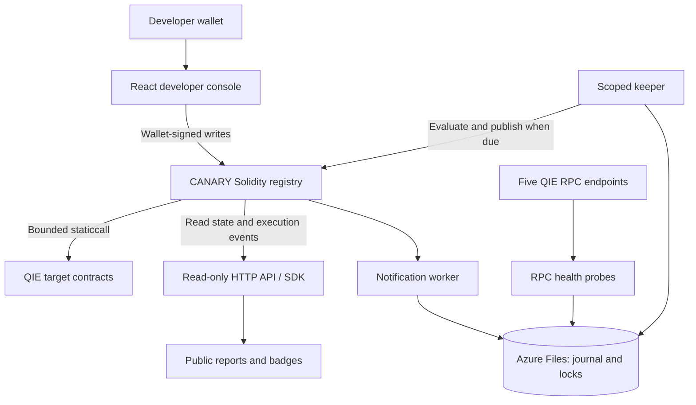

# CANARY

**Trust what works.**

On-chain condition verification and reliability monitoring for QIE developers. Define what must remain true about a deployed contract, publish reproducible execution evidence, and share it with applications and users.

[Live application](https://canary-production.whiterock-c7cbd84a.austriaeast.azurecontainerapps.io/) · [Public QIEDEX report](https://canary-production.whiterock-c7cbd84a.austriaeast.azurecontainerapps.io/#/p/1) · [Developer documentation](https://canary-production.whiterock-c7cbd84a.austriaeast.azurecontainerapps.io/#/docs) · [Mainnet registry](https://mainnet.qie.digital/address/0x153c1879c87b4130D4f0746A848133c3acF18eEB)

Built for QIE Blockchain Hackathon 3.0.

## Why CANARY?

A contract being deployed is not evidence that its configured operational assumptions still hold. Router mappings, balances, permissions and configuration values can change. A conventional monitoring dashboard can report what its own server observed, but another application may need a durable, independently inspectable record of a particular condition.

CANARY makes the condition itself a public on-chain policy. Any account can execute an active check against its registered target. The registry records the comparison result, observed value, block and time and emits an execution event. Applications can consume the evidence through a public report, badge, HTTP API or direct RPC SDK.

CANARY complements audits and monitoring tools; it does not replace them or prevent contract failures.

## How it works

1. **Connect** a detected EVM browser wallet on QIE Mainnet. The personal console displays projects owned by the selected address.
2. **Register** a project and a condition: target address, encoded call, expected value, comparison and maximum evidence age. Import an ABI, upload JSON or enter raw calldata.
3. **Evaluate** a condition without changing chain state. This preview is distinct from recorded evidence.
4. **Publish** by executing the registered condition through the registry. The transaction records a result and emits `CheckExecuted`.
5. **Integrate** the result into other applications using a public report, embedded badge, HTTP API or JavaScript SDK.

The hosted reference keeper periodically evaluates the three approved QIEDEX checks and publishes when a result changes or its evidence reaches 80% of the configured maximum age. Other projects can publish manually or operate a separately reviewed worker. Automatic hosted keeper enrollment is not implemented.

## Live mainnet evidence

The independently configured QIEDEX Pool Monitor demonstrates real contract reads on QIE Mainnet; it is not an official QIEDEX integration partnership or endorsement.

| Network / deployment | Value |
| --- | --- |
| Chain | QIE Mainnet (1990) |
| Registry | [`0x153c1879C87b4130D4f0746A848133c3acF18eEB`](https://mainnet.qie.digital/address/0x153c1879C87b4130D4f0746A848133c3acF18eEB) |
| Registry creation | [Transaction](https://mainnet.qie.digital/tx/0x25fe243b85b579fc45579205dd4453e083c22231782e32e3ab7df2b1762e883b) · block 12204684 |
| Reference project | [Project 1](https://canary-production.whiterock-c7cbd84a.austriaeast.azurecontainerapps.io/#/p/1) |
| Project registration | [Transaction](https://mainnet.qie.digital/tx/0x20ae0395ff64b45fa97eea71e9206677de97ffed3eacc941a54fbec5454a3372) |
| Keeper | [`0xB37b46F58cd7E384DbD051332EB0c6e110E3Ed7C`](https://mainnet.qie.digital/address/0xB37b46F58cd7E384DbD051332EB0c6e110E3Ed7C) |

### Configured policies

| Check | Target read | Expected |
| --- | --- | --- |
| 1 · Router factory unchanged | Router `factory()` | `0x8e23128a5511223be6c0d64106e2d4508c08398c` |
| 2 · WQIE/QUSDC pair mapping unchanged | Factory `getPair(WQIE,QUSDC)` | `0x73a3ccf7da7e473ed2e9994ae764f0e30f4e4dfe` |
| 3 · QUSDC pool balance floor | QUSDC `balanceOf(pair)` | At least 1,000 QUSDC (1,000,000,000 raw units) |

Each condition has a maximum evidence age of 3,600 seconds. Address outputs are compared as unsigned ABI words. The balance floor is a token balance check, not an assurance of solvency, reserves or executable liquidity.

### Automated cloud receipts

On 27 November 2026, the Azure keeper journaled, submitted and confirmed these three executions after the local keeper had been stopped:

| Check | UTC confirmation | Block | Result | Receipt |
| --- | --- | ---: | --- | --- |
| 1 | 09:50:15 | 12207340 | PASS | [0x0f1d…9b9e](https://mainnet.qie.digital/tx/0x0f1d800e6ed0e8575a7fbea6395ecb0b772d66eb694b600e56c867743a0e9b9e) |
| 2 | 09:50:44 | 12207347 | PASS | [0x2d21…3108](https://mainnet.qie.digital/tx/0x2d21fd32e8e30bb5a872a129e72fdbfa24d9056cd44f2a176230c55dc7c43108) |
| 3 | 09:51:09 | 12207354 | PASS | [0x4d70…ca8a](https://mainnet.qie.digital/tx/0x4d70d663fe30bb9b70fc2d1bc86cb19de392a0709e3f1ee44f0330bfed77ca8a) |

The production API subsequently reported four executions per condition (12 total), all passing at that snapshot. These are historical observations, not a promise of current status. The third receipt recorded 4,552.124907 QUSDC. Consult the live report for current evidence.

## Architecture



- **Solidity:** deterministic registry, owner-managed policies, permissionless execution and recorded evidence.
- **React / Vite / ethers:** wallet discovery, ABI builder, personal console, public reports and documentation.
- **Node.js:** HTTP API, read failover, RPC probes, incident reconstruction, notification worker and scoped keeper.
- **Azure Container Apps + Azure Files:** single-replica production service with persistent spending journal, RPC history and notification state.

### Safety and evidence semantics

| State | Interpretation |
| --- | --- |
| Passed | Active check has a recorded passing result within its allowed age. |
| Failed | Recorded comparison did not hold. |
| Error | Target execution failed or returned an incompatible result. |
| Stale | Recorded evidence is too old. |
| Unverified | No valid execution recorded. |
| Retired | Check no longer active. |
| Unavailable | Evidence could not be retrieved; never interpret as pass. |

A project passes only when it has active checks and all of them have fresh passing evidence. Static calls are gas-bounded and must return exactly one 32-byte word. The ABI builder supports unsigned integer and boolean outputs; address comparisons use raw calldata. Maximum age ranges from 60 seconds to 30 days; up to 64 checks per project including retired checks. Only owners can register or retire their project's conditions. Anyone can publish an active check.

## Run locally

Requirements: Node.js 22+, npm, an EVM browser wallet for signed actions, and QIE for gas if submitting mainnet transactions. No wallet is needed for public reports or read-only APIs.

```sh
npm ci
npm test
npm run build
node scripts/start-stack.mjs --production
```

Open `http://127.0.0.1:5173`. The committed `src/deployment.json` points to the existing QIE Mainnet registry. The default production stack has no signing keeper; it reads chain data and runs the loopback notification worker. Do not run a second instance against a shared state directory. For frontend development use `npm run dev`.

Docker (read-only with respect to blockchain writes):

```sh
docker build -t canary:local .
docker run --rm --init -p 127.0.0.1:5173:5173 canary:local
```

Do not provide private keys to these commands. The deployed mainnet registry does not need to be redeployed to review the application. Local test contracts are included for automated tests, not presented as mainnet assets.

## Integrate with CANARY

```sh
BASE=https://canary-production.whiterock-c7cbd84a.austriaeast.azurecontainerapps.io
curl -fsS "$BASE/v1/projects/1"
curl -fsS "$BASE/v1/infrastructure"
curl -fsS "$BASE/v1/notifications"
curl -fsS "$BASE/healthz"
```

| Endpoint | Purpose |
| --- | --- |
| `/v1/projects/:id` | Block-pinned project evidence and freshness counts |
| `/v1/infrastructure` | RPC monitoring history and keeper heartbeat |
| `/v1/notifications` | Operator-managed reference notification history |
| `/healthz` | Gateway liveness only, not chain or keeper health |

### JavaScript SDK

The SDK is supplied as source modules in this repository, not a published npm package.

```js
import { createCanaryHttp } from './sdk/http.mjs';

const client = createCanaryHttp(
  'https://canary-production.whiterock-c7cbd84a.austriaeast.azurecontainerapps.io'
);
const evidence = await client.getProject('1');
const expectedRegistry = '0x153c1879c87b4130d4f0746a848133c3acf18eeb';
if (evidence.chainId !== 1990 ||
    evidence.registry.toLowerCase() !== expectedRegistry ||
    evidence.allFreshPass !== true) {
  throw new Error('Expected fresh evidence unavailable');
}
console.log(evidence.block.number, evidence.checks);
```

Handle transport errors as unavailable evidence, verify deployment identity and re-fetch before relying on a result. Uint256 fields are decimal strings; use `BigInt` for arithmetic. Direct RPC clients can use `createCanary` from `sdk/canary.mjs` with the committed deployment configuration.

Embed a public badge:

```html
<iframe src="https://canary-production.whiterock-c7cbd84a.austriaeast.azurecontainerapps.io/#/badge/1"
        title="CANARY checks" width="350" height="108" style="border:0" loading="lazy"></iframe>
```

## Production operations

The current keeper is scoped to project 1 and checks 1–3. It validates chain ID, registry runtime, project ownership and exact approved policies, and records a fee reservation before broadcast. Pending receipts must reconcile before further writes. Its lifetime reservation cap is 0.25 QIE, maximum 300 transactions, maximum 0.0025 QIE per transaction and minimum 0.02 QIE wallet reserve. These are conservative limits, not actual gas costs or an indefinite service guarantee.

Azure secrets provide the dedicated signer only to the keeper process; no private key is bundled with the image or repository. Azure Files retains the mainnet state between revisions. Deployment requires a controlled shutdown and zero active replicas before a replacement worker starts. Never reset a journal or remove a lock while a worker may still be active. Abnormal shutdown recovery can require operator intervention. The hosted notification reference uses a loopback receiver; external signed webhook support is operator-configurable, not personal alert enrollment.

## Tests and release verification

Release 5 validation on 27 November 2026:

- 151 automated tests passed in the development tree, including contract execution, permissions, stale and unavailable evidence, wallet selection, owner filtering, budget and receipt validation, API routes and production gateway safeguards.
- Production Vite build and Linux AMD64 Docker build succeeded.
- Azure deployed image digest: `sha256:15c888bc38a1d01476c9dafeacb9115417a285b1c201ada2e445a39d9ab1a740`.
- Compiled production assets contained the updated personal console and documentation.
- Persistent storage write/rename and controlled restart tests succeeded; the restarted keeper subsequently confirmed the three transactions listed above.
- Staged frontend and script trees matched the deployment source; an initial Gitleaks scan reported no detected secrets. A secret scan is not a security audit.

## Repository map

```text
contracts/    Solidity registry and local test contract
src/          Developer console, public reports, documentation
scripts/      Deployment, API, keeper, RPC and notifications
sdk/          Direct RPC and HTTP clients
tests/        Automated contract and application tests
Dockerfile    Production image
```

## Scope and limitations

CANARY records configured comparisons, not comprehensive contract security, future correctness or economic solvency. Caller-dependent or hostile contracts may return misleading data. A block-pinned read is not a finality guarantee. Project filtering is a user experience feature, not privacy or authentication; registry data is public. Recent project discovery covers the latest 50 global IDs; older owned projects can be found by ID. Hosted automated monitoring and notification history are presently limited to the reference project. Unexpected shutdown recovery, automatic multi-project keeper enrollment, personal alert routing and commercial pricing validation remain future work.

See the [developer documentation](https://canary-production.whiterock-c7cbd84a.austriaeast.azurecontainerapps.io/#/docs) for check construction, contract methods, integration and troubleshooting.
